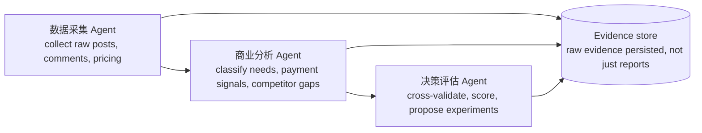

# Repository Guidelines

## Project Overview

DemandX is a **prompt/specification repository** for an "AI 商业机会调查与验证 Agent" — a market-research agent that finds product opportunities, collects first-hand user evidence, cross-validates it, and decides whether an idea is worth building.

Current state (verified 2026-10-29):

| Aspect | Status |
|---|---|
| Source code | **None** — no source files, manifests, or entry points |
| Build / lint / test tooling | **None** — no `package.json`, `tsconfig`, CI, or test runner |
| Content | Single 748-line Chinese document, `README.md` |
| Version control | One commit (`6650461 Initial commit`); the 746-line spec body is **uncommitted** (`git diff --stat` → `README.md | 746 +`) |

The repository is therefore **documentation-first**: the deliverable is the prompt methodology in `README.md`, not an application. Treat the README as the product spec; the software it describes does not exist yet.

## Architecture & Data Flow

No implemented architecture exists. The README describes an **intended** pipeline (`README.md:648-700`):



Three concepts the spec treats as hard interfaces — reuse these names and shapes if you implement it:

1. **Evidence unit** (`README.md:211-236`): link, platform, publish date, expressed problem, explicit need, products mentioned, price/payment mentions, whether first-hand, what it supports, what it does **not** prove.
2. **Five signal classes** (`README.md:238-288`): problem exists → actively seeking a solution → already paying → willing to switch → able to keep paying. Must be graded separately; never merged.
3. **Scoring** (`README.md:450-482`): 100-point rubric (needs 20 / payment 20 / differentiation 15 / acquisition 15 / profit 15 / feasibility 10 / longevity 5) plus an independent evidence-credibility grade **A–D**; every score must cite evidence.

Output contract: the 8-part report in `README.md:484-589` (executive summary → evidence → competitors → ranking → best direction → financial model → 14-day validation plan → final decision).

## Key Directories

| Path | Purpose |
|---|---|
| `README.md` | Product spec: prompt, methodology, rubrics, output format. Line anchors in this file point here. |
| `docs/superpowers/specs/` | Design specs: architecture, data model, scoring rules, UI architecture. |
| `docs/superpowers/plans/` | Task-by-task build plan (P0–P7). |
| `docs/design/` | Interactive prototype (`prototype/index.html`) and static wireframes (`mockups/`). |
| `src/app/` | Routes only: layouts, pages, route handlers. `(workbench)` is the app shell. |
| `src/features/` | Business components + server actions, one folder per domain; never import each other. |
| `src/components/ui/` | Token-only primitives (Button/Card/Sheet/Dialog/…); no business copy. |
| `src/components/shell/`, `src/components/common/` | App chrome and shared semantic badges. |
| `src/lib/` | Pure logic: `db/`, `hooks/`, `utils/`, and (soon) `llm/`, `pipeline/`, `evidence/`, `scoring/`. |
| `drizzle/` | Generated SQL migrations. Never edit by hand; change schema + `pnpm db:generate`. |
| `tests/e2e/` | Playwright specs. |
| `.worktrees/` | Git-ignored isolated worktrees. |

## Development Commands

```bash
pnpm install
docker compose up -d        # Postgres 16 on 127.0.0.1:5433 (5432 is occupied on this machine)
pnpm db:generate            # schema -> drizzle/*.sql
pnpm db:migrate             # apply migrations (idempotent)
pnpm dev                    # http://127.0.0.1:3000
pnpm verify                 # typecheck + lint + unit tests, must stay green
pnpm test                   # vitest (unit-node + unit-dom projects)
pnpm e2e                    # Playwright (starts dev server automatically)
pnpm tokens:check           # fails on hard-coded colours outside globals.css
```

## Code Conventions & Common Patterns

Enforced by tooling (see `eslint.config.mjs`, `scripts/check-tokens.mjs`):

- **Colours only via semantic tokens** (`bg-surface`, `text-fg`, `border-border`, `bg-accent`, `text-success`, `text-on-accent`). No hex/rgb/hsl in `src`, no `dark:` prefixes — dark mode swaps the `[data-theme='dark']` variable set.
- **Dependency direction**: `app → features/components → components/ui → lib`. Features must not import each other; `eslint-plugin-boundaries` blocks it.
- **Hooks live in `src/lib/hooks/`** and are tested with `renderHook`; components stay declarative.
- **External input is parsed with zod** before it reaches typed code; fallible operations return a discriminated `Result` rather than throwing across layers.
- **Server Components by default**; `'use client'` only for stateful islands (palette, tables, forms, charts).
- **No global state library.** Reads go through RSC + Drizzle, mutations through Server Actions, live progress through SSE with `after_seq` resume.

Documentary discipline for any research output still applies — these are the spec's mandatory rules (`README.md:591-610`):

- **Never fabricate evidence.** No invented posts, comments, user counts, sales, prices, revenues, or statistics. Missing data is marked `未知` (unknown), not estimated silently.
- **First-hand over second-hand.** Cite reachable original threads/pages; a search summary is not a verified source. State when a platform could not be fully accessed.
- **Separate fact, inference, unknown.** Preserve that three-way distinction in every claim.
- **Never conflate signals.** Discussion volume ≠ market demand; demand ≠ willingness to pay; free users ≠ commercial value; downloads/views/likes ≠ paying users; an existing competitor ≠ proven market size.
- **Every estimate ships its formula, assumptions, and uncertainty.** TAM/SAM/SOM must be bottom-up, never "billions of netizens therefore large market".
- **Negative evidence is mandatory.** Ask why users do *not* buy, cancel, or stay on free alternatives.
- **Decision is one of five** (`README.md:577-589`): 建议开发 / 建议先验证再开发 / 建议调整定位 / 建议暂缓 / 建议放弃.

Editing conventions for `README.md` itself:

- **Chinese prose**, Markdown headings; the top-level prompt uses numbered Chinese sections 一→十三, then commentary restarts at 二→五 — keep numbering consistent if you insert sections.
- Preserve the structure: `#` for prompt sections, `##`/`###` for sub-points, `***` as inter-part separators, tables for rubrics and comparisons.
- Code-fence nothing but commands/JSON; the document is prose, not executable.
- Keep the strength of modal language: 必须 / 不得 are load-bearing rules, 建议 is advisory. Downgrading 必须 to 建议 changes the spec.

## Important Files

| File | Role |
|---|---|
| `README.md:3-622` | The copy-paste prompt: role, founder constraints (solo/small team, ≤¥3000 budget, front-end dev), search strategy, evidence rules, 5 signals, competitor/business-model/market/cost/acquisition analysis, rubric, report format, 18 mandatory rules. |
| `README.md:626-642` | Core thesis: search for problems users **already pay to solve**, not problems they merely complain about. |
| `README.md:648-700` | 4-phase workflow: discover → validate commercial value → validate feasibility → validate real payment. |
| `README.md:704-726` | Intended 3-agent decomposition + "persist raw evidence, not just reports". |
| `README.md:730-748` | Final operating principle: paid demand first, better solution second; validate payment before building. |
| `AGENTS.md` | This file — assistant orientation. |
| `docs/superpowers/specs/2026-10-29-demandx-design.md` | Current design spec (draft, pending approval): zero-cost local stack, configurable LLM providers, data model, pipeline DAG, scoring rules, crawler design, 28-day delivery plan. Read it before any implementation work. |
| `docs/superpowers/specs/2026-10-29-demandx-ui-design.md` | Page architecture: route inventory, per-page tech stack (AI SDK `useChat`, Streamdown, TanStack Table, recharts, dnd-kit, nuqs), alignment with vercel/chatbot, design tokens, perf budgets, page-level tests. |
| `docs/superpowers/plans/2026-10-29-demandx-build-plan.md` | Task-by-task build plan P0–P7 (28 days): exact files, commands, acceptance, commits, plus the enforced engineering rules (token-only colors, boundary lint, hook encapsulation). |
| `docs/design/prototype/` | Interactive high-fidelity prototype (open `index.html`): chat, report, evidence, settings, home, plus 2x screenshots. |

## Runtime/Tooling Preferences

- **No runtime, package manager, or version pinning is declared.** Nothing to infer from; do not assume Node, Bun, Python, or Swift.
- `.idea/swift-toolchain.xml` and `DemandX.iml` (`WEB_MODULE`) exist, but there is no `Package.swift` or Swift source — [INFERENCE] IDE configuration only, **not** evidence of a chosen stack. Do not present Swift as the project's language.
- Editing is plain Markdown; UTF-8, Chinese text. Git is the only tool with a real convention here: work on `main`, commit messages in the existing terse style (`Initial commit`).
- The spec's external dependencies are *research targets* (小红书, V2EX, Reddit, Hacker News, G2, App Store, official pricing pages), not services the repo calls. No API keys or env vars are defined anywhere.

## Testing & QA

- **No test framework, coverage config, or CI workflow exists.** `README.md` uses "测试" only in the market sense (price testing, `README.md:560-576`), never software QA.
- QA for this repo is **editorial**: the spec must remain internally consistent — signal definitions, rubric weights (must total 100), report sections, and the 18 mandatory rules must not contradict each other or the commentary parts.
- Before claiming a change is done, verify the claim against the file: re-read the edited range and cite `README.md:<line>` for assertions about the spec. Do not claim tests ran; there are none.
- If code is introduced, this section must gain the actual runner command, test layout, and coverage expectation in the same change.

## Working Agreements for AI Assistants

1. **State present vs planned.** The 3-agent architecture and evidence database are *proposals* (`README.md:704-726`). Never describe them as implemented.
2. **Anchor every spec claim** to `README.md:<line>`; the document is the only source of truth.
3. **Answer in the spec's register** when asked to run the methodology: Chinese output, evidence-first, explicit unknowns, one of the five decisions at the end.
4. **Do not add scaffolding** (empty dirs, stub manifests, "MVP" code) to make the repo look like a software project. Code lands only when the user asks for implementation.
5. **The uncommitted README is intentional user work** — adapt to it, never revert or reflow it to match `HEAD`.

<!-- BEGIN:nextjs-agent-rules -->

## This is NOT the Next.js you know

This version has breaking changes — APIs, conventions, and file structure may all differ from your training data. Read the relevant guide in `node_modules/next/dist/docs/` (resolved from this file's directory; in monorepos the `next` package may not be visible from the repo root) before writing any code. Heed deprecation notices.

This block is written and re-added by `next dev` — verify at `node_modules/next/dist/server/lib/generate-agent-files.js`. Removing it from a diff only re-creates the uncommitted change; committing it with your work keeps the tree clean.

<!-- END:nextjs-agent-rules -->
