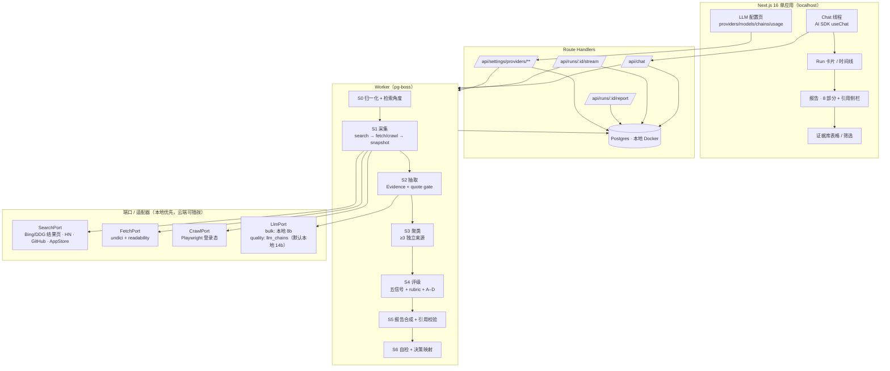

# DemandX 设计规格（Design Spec）

- 状态：待用户评审（draft）
- 日期：2026-10-29（v3：本地批量 + 云端合成，零边际成本）
- 目标读者：实现者（含 AI 编码助手）
- 依据：`README.md` 的提示词方法论（证据优先、五信号、百分制 + A–D 可信度、八部分报告、五选一决策）

## 1. 决策记录

| 决策 | 选择 | 放弃的方案与原因 |
|---|---|---|
| 产品形态 | **单人研究工作台**（无登录、无计费） | 多租户 SaaS：方法未验证就投基础设施；开源模板：变现后置且维护成本高 |
| 界面 | **Chat 优先**（AI SDK + shadcn，对齐 vercel/chatbot） | 纯表单 + 报告：无法追问单个论断；assistant-ui：与参考项目 parts 模型重复 |
| 国内数据源 | **自建 Playwright 爬虫（登录态）** | 人工导入：覆盖不足；第三方数据商：按量计费且稳定性外包 |
| 运行成本 | **零边际成本默认 + 可插拔云端**：批量抽取固定走本地 Ollama；合成走「质量链」，链内容由配置页决定（默认仅本地，可加入任何 OpenAI/Anthropic/Google 兼容端点，如 OpenCode Go） | 硬编码某一家套餐（ARK/OpenCode）：套餐会到期、条款会变、模型会下线 |
| LLM 接入方式 | **可视化配置页**：provider（baseURL/key/额外 header）→ 模型列表 → 两条链（bulk/quality）→ 连通性测试 → 配额视图；存 DB，不依赖环境变量 | 仅环境变量：改一次模型要重启、无法展示连通性与剩余额度 |
| 编排 | 纯 TypeScript DAG + `pg-boss` | LangGraph/Mastra：本流程无环、需可重放，框架带来状态与调试成本 |
| 评分 | **代码计算**，LLM 只填带引用的字段 | LLM 直接给分：不可复现、无法审计，违反 README 反幻觉要求 |
| 聊天层 | **对齐 vercel/chatbot**：`ai@7` + `@ai-sdk/react` + `streamdown`（含 cjk/code 插件）+ shadcn/Radix + `use-stick-to-bottom` | assistant-ui：与参考项目的 message-parts 渲染模型重复，且多一层 runtime 抽象 |

用户已确认：单人工作台、Chat 优先、自建爬虫、零边际成本默认（2026-10-29）。外部 LLM 一律通过配置页接入，不绑定任何具体厂商或 CLI 工具。爬虫的 ToS 风险见 §13。

## 2. 目标与非目标

**目标**

1. 输入一个产品 Idea（或一段用户抱怨原文），产出一份**可逐条追溯**的八部分研究报告。
2. 每条论断挂 `evidence_id`；引用必须是原始快照的精确子串，否则丢弃。
3. 评分与可信度可复现：同一输入、同一证据集，得分恒定。
4. **默认零边际成本，云端可选且可插拔**：批量推理固定在本地；每次研究仅 4–6 次高质量合成调用走「质量链」，链默认只含本地模型，可在配置页加入任意兼容端点（OpenCode Go、Gemini 免费层、OpenRouter 等）。单 run 墙钟上限 90 分钟，超时用已有证据出降级报告。
5. 第 14 个工作日产出第一份真实报告；第 28 个工作日能对一个真实方向给出五选一决策。

**非目标（本版不做）**

- 任何需要付费的 API、云托管、域名与备案（仅 `localhost`）。
- 多用户、鉴权、计费、团队协作。
- 绕过验证码、指纹伪装、代理池轮换（明确不做，见 §11）。
- 自动生成落地页 / 自动投放广告。
- 移动端 App、微信小程序。
- 多语言界面（界面与报告均为中文）。

## 3. 已核实事实基线（2026-10-29）

| 事实 | 验证方式 |
|---|---|
| 本机 Apple M2 / 24 GB / macOS 27.0.1 / 可用磁盘 129 GB；Docker 已装，Ollama 未装，`psql` 未装 | `sysctl`、`sw_vers`、`df -h`、`command -v` |
| Ollama 支持 JSON Schema 结构化输出，JS 侧可用 `z.toJSONSchema(zodSchema)`，并支持 OpenAI 兼容接口 | docs.ollama.com/capabilities/structured-outputs |
| Ollama `qwen3` 提供 0.6b/1.7b/4b/8b/14b/30b/32b/235b 标签 | ollama.com/library/qwen3 |
| Gemini 免费层：`gemini-3.8-flash` 输入/输出免费，但**不含** Search grounding，且免费层内容会用于改进产品 | ai.google.dev/gemini-api/docs/pricing |
| OpenRouter `:free` 模型限额：<10 美元充值额度时为 **20 req/min、50 req/day** | openrouter.ai/docs/api-reference/limits |
| Google Custom Search JSON API **已停止对新客户开放**，2027-01-01 停服 | developers.google.com/custom-search/v1/overview |
| Reddit 公开 `.json` 返回 **403**，需 OAuth | `curl reddit.com/search.json` |
| 小红书搜索页 301 → 前端渲染，无公开搜索 API | `curl xiaohongshu.com/search_result` |
| App Store 评论 RSS 返回 JSON，无需 key | `itunes.apple.com/rss/customerreviews/...json` |
| HN Algolia 无需 key | `hn.algolia.com/api/v1/search` |
| GitHub 搜索 API 匿名可用（限流 10 req/min） | `api.github.com/search/repositories` |
| Exa 免费额度 $10/月（≈2,500 lite 搜索），Tavily 免费 1,000 credits/月 | 各自 pricing 页（仅作可选加速，非必需） |
| OpenCode Go：$10/月（Go）、$40（Go Plus）、$20/席位（Teams）；按「每月美元额度」计量，每模型有 5 小时 20% / 每周 50% 子限额 | opencode.ai/v2/docs/console/go |
| OpenCode Go 数据面 `https://opencode.ai/inference/go` + `/openai/v1/chat/completions`；要求 `x-opencode-session` 会话头，客户端须带自己的 UA；官方声明「为 OpenCode 与类似 coding agent 设计，会监控滥用」 | opencode.ai/v2/docs/console/harnesses |
| OpenCode Console 的 **free 模型仅限 OpenCode 客户端**，其他客户端带 key 也返回 403 | opencode.ai/v2/docs/console/harnesses |
| OpenCode 默认屏蔽「训练数据的付费端点」，允许区域为欧洲与美国；无隐私设置的 workspace 额外允许来自中国的 Global 请求；DeepSeek 需在 Settings › Privacy 选 Global | opencode.ai/v2/docs/console/go（Enable restricted models） |
| OpenCode 模型清单可 GET `https://opencode.ai/inference/v1/models` | opencode.ai/v2/docs/console/models |
| 工具版本：Node 22.20、pnpm 9.12、Next 16.4.3、ai 7.0.156、@ai-sdk/react 4.0.16、streamdown 2.7.1、pg-boss 12.38、drizzle-orm 0.45.4、playwright 1.64.1、vitest 5.0.5、zod 4.6.7 | `npm view` 实测 / vercel/chatbot package.json |

## 4. 架构总览



**关键结构约束**：stage 之间只通过可序列化的 `RunContext` 传递状态；每个 stage 幂等，可按 `(run_id, stage, input_hash)` 断点续跑。推理后端只通过 `LlmPort` + `llm_chains` 暴露，因此换模型、加 provider 都是配置操作，不触碰流水线代码。

## 5. 组件与职责

| 组件 | 路径 | 职责 | 依赖 |
|---|---|---|---|
| Chat UI | `src/components/chat/**` | 线程、消息 parts 渲染、composer、工具卡片、审批卡 | `@ai-sdk/react`、`streamdown`、`use-stick-to-bottom` |
| 报告页 | `src/app/runs/[runId]/report/page.tsx` | 八部分渲染、引用侧栏、缺口标注 | 只读 DB |
| 证据库 | `src/app/runs/[runId]/evidence/page.tsx` | 表格、按信号筛选、人工确认 | 只读 DB |
| LLM 配置页 | `src/app/settings/llm/**` + `src/app/api/settings/providers/**` | provider/model/链/用量 CRUD、连通性测试、Key 加密与掩码 | DB、LlmPort |
| Chat API | `src/app/api/chat/route.ts` | 流式对话 + 工具执行（`start_research` 等） | LlmPort |
| Run API | `src/app/api/runs/**` | 创建 run、SSE 事件流 | pg-boss |
| Worker | `src/worker/main.ts` | 消费队列、跑 DAG、写事件 | pg-boss |
| 端口层 | `src/lib/ports/**` | `SearchPort`/`FetchPort`/`CrawlPort`/`LlmPort` 接口与适配器 | 本地服务 / 免费端点 |
| 抽取 | `src/lib/evidence/**` | schema 校验、quote gate、去重 | LlmPort |
| 评分 | `src/lib/scoring/**` | 五信号计分、rubric、可信度、决策映射（**纯函数**） | 无 IO |
| 报告 | `src/lib/report/**` | 装配、引用校验、导出 | 评分结果 |
| 配额 | `src/lib/quota/**` | 每 provider 计数、耗尽降级、墙钟看门狗 | 无 IO |
| DB | `src/lib/db/**` | Drizzle schema、迁移、查询 | 本地 Postgres 16 |

页面清单、每页技术栈、布局与前端依赖见 `docs/superpowers/specs/2026-10-29-demandx-ui-design.md`。

## 6. 数据模型

```
ideas(id, title, raw_input, constraints jsonb, created_at)
runs(id, idea_id, status, stage, deadline_at, chain_snapshot jsonb,
     started_at, finished_at, error jsonb)
run_events(id, run_id, seq, type, payload jsonb, created_at)   -- 追加写，SSE 依据 seq 续传
queries(id, run_id, angle, provider, text, result_count)
sources(id, run_id, canonical_url, platform, fetched_at, content_hash,
        snapshot_path, http_status, crawl_tier)                -- UNIQUE(canonical_url, content_hash)
evidence(id, run_id, source_id, quote, quote_offset, platform, published_at,
         signal, first_hand, price_mentioned, supports, does_not_prove,
         rejected_reason, created_at)                          -- quote 必须是快照正文子串
opportunities(id, run_id, name, positioning, independent_sources, evidence_ids int[])
scores(opportunity_id, dimension, points, rationale, evidence_ids int[])
reports(id, run_id, sections jsonb, rubric_total, credibility_grade, decision, unknowns jsonb)
citations(report_path, evidence_id)                             -- report_path 如 "part2.evidence[3].claim"
threads(id, idea_id, title, created_at)
messages(id, thread_id, role, parts jsonb, created_at)
api_calls(id, run_id, provider_id, model, kind, prompt_tokens, completion_tokens,
          allowance_usd numeric, created_at)

-- LLM 配置（可视化页面读写，替代环境变量）
providers(id, name, kind, base_url, api_key_ct, api_key_hint, headers jsonb,
          enabled bool, monthly_allowance_usd numeric, created_at, updated_at)
-- kind: openai-compatible | anthropic-compatible | google | ollama
provider_models(provider_id, model_id, display_name, context_tokens,
                supports_json bool, source, PRIMARY KEY(provider_id, model_id))
llm_chains(profile, position, provider_id, model_id, PRIMARY KEY(profile, position))
-- profile: bulk | quality
provider_usage(provider_id, window, window_start, requests, prompt_tokens,
               completion_tokens, allowance_usd, PRIMARY KEY(provider_id, window, window_start))
-- window: 5h | weekly | monthly | day
```

索引：`evidence(run_id, signal)`、`sources(canonical_url)`、`run_events(run_id, seq)`、`api_calls(run_id, provider_id)`、`llm_chains(profile, position)`。

`signal` 枚举固定为 `problem | seeking | paying | switching | recurring`，与 README 五信号一一对应，**不合并、不取平均**。

**金额只作为第三方套餐配额的计量单位**：`providers.monthly_allowance_usd`（用户手动声明，如 OpenCode Go 的 $80/月）与 `provider_usage.allowance_usd`（provider 回报的消耗）。系统不做支出记账、不显示“花了多少钱”给 run，只用它判断“还能不能继续调”。

## 7. 契约

```ts
// 证据：LLM 唯一允许产出的市场事实单元
type Evidence = {
  sourceId: number;
  quote: string;            // 必须为快照正文精确子串
  platform: 'xiaohongshu'|'douyin'|'zhihu'|'v2ex'|'reddit'|'hn'|'appstore'|'github'|'web';
  publishedAt: string | null;   // ISO，未知则 null
  signal: 'problem'|'seeking'|'paying'|'switching'|'recurring';
  firstHand: boolean;
  priceMentioned: { amount: number; currency: string } | null;
  supports: string;         // ≤120 字，这条证据支持什么
  doesNotProve: string;     // ≤120 字，这条证据不能证明什么
};

type StageContext = {
  runId: number;
  deadlineAt: Date;                       // 墙钟看门狗
  models: { bulk: ChainItem[]; quality: ChainItem[] };    // 从 llm_chains 快照，run 期间不变
  angles: string[];
};

interface SearchPort { search(q: string, opts: { limit: number; recencyDays?: number }): Promise<SearchHit[]> }
interface FetchPort  { fetch(url: string): Promise<Snapshot> }        // 静态，undici + readability
interface CrawlPort  { crawl(url: string): Promise<Snapshot | { status: 'needs_human'; reason: string }> }

type ProviderKind = 'openai-compatible' | 'anthropic-compatible' | 'google' | 'ollama';
type ChainItem = { providerId: number; providerName: string; kind: ProviderKind; modelId: string };

interface LlmPort {
  // profile 决定用哪条链：bulk = 高并发大量小请求；quality = 少量高难度请求
  structured<T>(schema: ZodType<T>, prompt: Prompt, o: { profile: 'bulk'|'quality' }):
    Promise<{ data: T; used: ChainItem; usage: { in: number; out: number } }>;
  text(prompt: Prompt, o: { profile: 'bulk'|'quality' }):
    Promise<{ text: string; used: ChainItem; usage: { in: number; out: number } }>;
}
```

**Provider 链（数据驱动，存 `llm_chains`；任一环节失败自动落到下一项）**

| profile | 默认链 | 调用量/run | 用途 |
|---|---|---|---|
| `bulk` | `ollama/qwen3:8b` → `ollama/qwen3:14b` | ~120 | S2 逐页抽取（机械、低难度、被 quote gate 兜底） |
| `quality` | `ollama/qwen3:14b`（默认唯一项） | 4–6 | S0 角度生成、S3 聚类、S5 报告合成、S6 自检 |

- 链中每一项是 `(provider_id, model_id)` 引用，顺序由配置页拖拽决定，**不写死在代码或环境变量里**。
- 默认两条链都只含本地 Ollama ⇒ 开箱即零成本；用户可在配置页把 OpenCode Go、Gemini、OpenRouter 或任何自建端点插入 `quality` 链首位。
- 每次调用记录 `provider_id`、`model`、token 数与 provider 回报的 allowance，报告页脚标注“合成模型：X”。
- 降级是**逐项**的：某 provider 401/403/429/超时/额度耗尽 → 标记该 provider 在当前窗口不可用 → 同一条消息内继续尝试下一项；全部失败则 stage 失败并写明每项的真实错误。

### 7.1 LLM 配置页（`/settings/llm`）

**页面结构（四块）**

| 区块 | 内容 | 关键交互 |
|---|---|---|
| Providers | 名称、类型（openai-compatible / anthropic-compatible / google / ollama）、Base URL、API Key、额外 headers（JSON）、启用开关、月额度（USD，可选） | 新增/编辑/删除；Key 只显示 `sk-…abcd` 掩码；"测试连接"按钮 |
| Models | 每个 provider 下的模型清单 | "拉取模型"调用 `GET {base}/models`（Ollama 用 `/api/tags`）；无该端点时手动添加；可标记 `supports_json` |
| Chains | `bulk` 与 `quality` 两列 | 拖拽排序、增删、灰度显示不可用 provider；保存前校验“链非空” |
| Usage | 各 provider 的 5h / 本周 / 本月用量与额度（来自 `provider_usage`） | 进度条 + "重置窗口"按钮（仅清本地计数） |

Providers 的「添加」默认从**目录**（`https://models.dev/api.json`，24h 缓存）选择：按
`npm` 映射到四种 kind、按 国内 / 海外 / 本地 分组，选中后预填名称 / Base URL / 环境变量
提示并带入模型清单；目录不可用时回退内置预设并在 UI 显式标注，不阻断添加。

**连通性测试（Server Action 执行，结果回填页面）**

```ts
// features/settings/llm/actions.ts → testProvider(id)
// 发一条 max_tokens=8 的请求，返回：
{ ok: true,  latencyMs: 812, model: 'glm-5.3', providerReportedAllowance: 0.0004 }
{ ok: false, status: 403, error: 'Free-tier models require the OpenCode client' }  // 原样透出
```

错误**逐字展示**，不改写为“配置有误”——403/401/429 的处理方式完全不同（换模型 / 换 key / 等窗口）。

**预置模板（一键填入，仍需用户自己提供 key）**

| 模板 | Base URL | 额外 header | 备注 |
|---|---|---|---|
| OpenCode Go | `https://opencode.ai/inference/go` | `x-opencode-session: <uuid>`（每次对话固定） | 用 `/openai/v1/chat/completions`；仅 Go 已订阅模型；free 模型会 403 |
| OpenCode PAYG | `https://opencode.ai/inference` | `x-opencode-session` | 按量计费，会真扣余额，需用户显式勾选"我知道这是按量计费" |
| Ollama（本地） | `http://127.0.0.1:11434/v1` | — | 默认 provider，无需 key |
| 任意 OpenAI 兼容 | 用户填写 | 可选 | 覆盖 GLM/Kimi/DeepSeek 官方端点等 |

**安全与生效规则**

- Key 用 AES-256-GCM 加密后存 `api_key_ct`；密钥放 `~/.demandx/secret.key`（`chmod 600`），**不入库、不入 git**；日志与错误信息统一脱敏。
- 生效时机：run 创建时把两条链**快照**进 `runs.chain_snapshot`，该 run 全程只用快照；下一次 run 使用新配置。避免中途换模型污染同一份报告。
- 页面仅在 `localhost` 可访问；写接口要求同源 POST + CSRF token。
- 删除 provider 时，若被链引用则拒绝并列出引用位置，不做级联删除。

SSE 事件：`stage.started` / `stage.finished` / `evidence.added` / `evidence.rejected` / `quota.warning` / `report.ready` / `run.failed`。客户端断线后用 `?after_seq=N` 续传。

Chat 工具（模型可调用；每次外部请求前经 `src/lib/quota` 计数校验）：

| 工具 | 参数 | 行为 |
|---|---|---|
| `start_research` | `idea, angles?` | 返回耗时预估卡（按 25s/页 估算），用户确认后才入队 |
| `import_evidence` | `url? \| text?` | 抓取或粘贴入证据库，仍走 quote gate |
| `query_evidence` | `signal?, platform?, q?` | 只读检索，返回 ≤20 条 |
| `generate_report` | `runId` | 触发 S5–S6 |

## 8. 流水线 DAG

| 阶段 | 输入 → 输出 | 失败处理 |
|---|---|---|
| S0 | Idea 文本 → 5 类检索角度（需求/缺陷/付费/替代/频率），每类 3–5 条查询 | 模型输出不合 schema → 重试 2 次 → 用模板查询兜底 |
| S1 | 查询 → `sources` + 快照 | 单源失败不计 run 失败；每域名最多 30 页；抓取失败记 `http_status` |
| S2 | 快照正文 → `evidence` | quote 非子串 → 写 `rejected_reason='quote_not_in_snapshot'`，不计入评分 |
| S3 | evidence → opportunities | 独立来源 < 3 的簇降级为 `signal=problem` 的单条记录，不生成机会 |
| S4 | opportunities → `scores` | 纯函数，无外部调用 |
| S5 | 评分 + evidence → `reports.sections` | 无引用论断移入 `unknowns`，不进入正文 |
| S6 | 报告 → 校验 + 决策 | 校验失败不发布报告，返回具体失败项 |

每阶段结束写 `run_events`，并把 `runs.stage` 前移；worker 崩溃后从最后完成的 stage 续跑。**S1–S5 每一步先检查 `deadlineAt`**，超时则跳过剩余采集、用已有证据进入 S5。

## 9. 评分规则（代码实现，禁止 LLM 给分）

**计数项**（从 `evidence` / 竞品表聚合，全部去重）：

- `n`：独立来源数 = 去重 `canonical_url` 且去重作者的来源数。
- `p`：付费证据条数（用户自述已完成购买/订阅/付费人工服务）。
- `c`：直接竞品数 = 附官网 URL 且去重域名的竞品数。
- `comp`：竞品差评证据条数（针对具体竞品的“太贵/难用/缺功能”一手评价）。
- `r`：持续使用/续费/流失原因证据条数。

| 维度 | 上限 | 规则 |
|---|---|---|
| 真实需求 | 20 | n≥10→20；5–9→16；3–4→11；1–2→6；0→0 |
| 付费意愿 | 20 | p≥5→20；3–4→17；2→13；1→8；0→0；且若 p>0 但无一条含可核实价格页，封顶 10 |
| 竞品缺口 | 15 | c≥3→10，2→6，1→3，0→0；再加 comp≥3→+5，1–2→+3 |
| 获客可行性 | 15 | LLM 给 0–3 序数并附 ≥1 条渠道证据，代码 ×5；无证据→0 |
| 收入潜力 | 15 | LLM 给 0–3 序数（依据价格证据 + 成本证据），代码 ×5；无价格证据→0 |
| 技术可行性 | 10 | LLM 给 0–2 序数并列出依赖/合规约束，代码 ×5 |
| 长期潜力 | 5 | r≥3→5，2→3，1→2，0→0 |

合计恒为 100 上限；写入 `reports.rubric_total` 前断言 `sum(points) === rubric_total`，超过上限则该维度截断并记 `unknown_reason`。

**序数锚点**（LLM 只选择档位，不得给连续分；每档必须附 `evidence_ids`，否则降为 0）：

| 维度 | 0 | 1 | 2 | 3 |
|---|---|---|---|---|
| 获客可行性 | 无任何可行渠道证据 | 仅泛化渠道（“发小红书”“做 SEO”） | 具体社区/关键词/帖子位置证据 | 有已付费投放、渠道成本或社区版主/群主入口证据 |
| 收入潜力 | 无价格证据 | 只有免费替代品 | 竞品有公开定价页 | 用户已实际支付的价格 + 可覆盖成本的结构 |
| 技术可行性 | 存在不可控依赖或合规阻断 | 依赖第三方但可替换 | 全部可用现成 API / 开源组件 | — |

**可信度**

| 等级 | 条件 |
|---|---|
| A | 需求 ≥16 且 付费 ≥13，且全部论断有引用，且独立来源 ≥3 |
| B | 需求 ≥11 且论断有引用，且独立来源 ≥3 |
| C | 需求 6–10，或独立来源 ≤2 |
| D | 需求 <6，或无任何可追溯来源 |

A 是 B 的严格子集（两者同用独立来源 ≥3 的门槛，A 另加需求与付费的顶档），B 覆盖 11–15 需求区间。判定时先查“无任何可追溯来源”（独立来源 = 0）直接给 D，再按 A → B → C → D 顺序求值，先中先返回；C 的来源下限只覆盖 1–2。2 个来源即使引用齐全也只到 C —— 交叉验证不足的机会不得进入“建议开发”。

**决策映射**（按顺序求值，先中先返回）

1. 可信度 D，或（需求 ≤6 且付费 = 0）→ `建议放弃`
2. 付费 ≤6 且总分 <50 → `建议调整定位`
3. 技术可行性 ≤5 且总分 ≥50 → `建议暂缓`
4. 总分 ≥70 且可信度 A/B → `建议开发`
5. 其余 → `建议先验证，再开发`（并给出成本最低的验证实验）

## 10. Chat 优先交互

```
用户：我想做一个「跨境卖家多平台库存同步」工具
  ↓ start_research（预估 35 分钟 · 本地推理，耗时预估卡）
[开始研究]  [调整角度]
  ↓ run 卡片实时推进：S1 采集中 12/40 → 发现 6 条付费证据
  ↓ 报告就绪
助手：结论「建议先验证」68/100（可信度 C）… [打开报告] [只看付费证据]
用户：为什么付费证据只有 B 级？
  ↓ query_evidence(signal='paying')
助手：3 条，其中 1 条有价格页（¥99/月），2 条仅为口头意愿 → 引用 [e12][e19]
```

规则：**助手任何市场论断必须携带 `[eN]` 引用**；无证据时输出“没有找到足够证据”，不得改写为推测。Run 卡片可点击跳转到证据行。**界面不出现任何金额或预算概念**，只有剩余时间与配额状态。

## 11. 爬虫子系统

- 分层：tier1 静态抓取（undici + readability）→ 失败或需登录时 tier2 Playwright。
- 登录：`pnpm crawl:login <platform>` 打开有头浏览器，用户手动登录；会话存 `~/.demandx/browser/<platform>/`（**不入库、不入 git**）。
- 限速：每域名并发 1，请求间隔 3–8s 随机；每 run 每域名 ≤30 页；单 run 墙上时间上限 90 分钟。
- 挑战处理：检测到验证码/登录墙 → 写 `needs_human`，暂停该域名并在 UI 提示；**不自动破解、不轮换代理、不做指纹伪装**。
- 快照：`data/snapshots/<sha256>.html.gz` + 抽取正文入 DB；保留 90 天。
- 合规开关：`CRAWL_ENABLED=false` 时全部降级为 tier1 + 手动导入；`CRAWL_RESPECT_ROBOTS=true` 默认开启（对 `Disallow` 路径直接跳过并记录）。
- 许可与责任说明写入 `docs/crawling.md`，README 顶部披露采集范围。

## 12. 零边际成本与配额护栏

**零边际成本的资源表**

| 资源 | 免费实现 | 单 run 用量 | 备注 |
|---|---|---|---|
| 批量推理 | 本地 Ollama `qwen3:8b`（降级 `14b`） | ~120 次抽取 | M2 24GB 可同时驻留 2 个 8b 实例 |
| 高质量推理 | 由 `quality` 链决定；默认本地 `qwen3:14b`，可按需插入 OpenCode Go（已订阅时）、Gemini 免费层、OpenRouter `:free` | 4–6 次/run | 链中任一项不可用即自动降级，run 不中断 |
| 网页搜索 | Playwright 抓 Bing / DuckDuckGo 结果页 | 60 次查询 | 与爬虫共用限速器 |
| 结构化数据 | HN Algolia、GitHub Search、App Store RSS | 各 ≤30 | 无 key、无费用 |
| 抓取 | 本地 Playwright + undici | 120 页 | 免费 |
| 存储 | 本地 Postgres（Docker）+ 磁盘 | ~200 MB/run | 已有 129 GB 可用 |
| 可选加速 | Exa $10/月、Tavily 1,000 credits/月、Gemini Flash 免费层 | 0–5 次 | **默认关闭**，开启也不产生现金支出 |

**耗时（不是花费）**：M2 24GB 上 8B q4 约 25–35 tok/s，单页抽取约 18–25s；并发 2 时单 run **25–45 分钟**，硬上限 90 分钟。`start_research` 的预估卡显示这个时间。

**外部套餐 provider 的边界（以 OpenCode Go 为例，写进实现而不是只写文档）**

- **接口形态可用**：`https://opencode.ai/inference/go` + `/openai/v1/chat/completions`，`ai@7` 的 openai-compatible 直接接；每次请求需带固定 `x-opencode-session`，并带自己的 UA。
- **free 模型用不了**：Console 的 `*-free` 模型只允许 OpenCode 客户端，其他客户端即使带 key 也返回 **403**。配置页必须在拉取模型时标注 `availableExternally: false`，避免用户把它们排进链。
- **额度是美元额度**：OpenCode Go 按「每模型每月美元额度」计费，且每模型有 5 小时 20% / 每周 50% 的子限额。因此配置页要求用户**手动声明**每个 provider 的月额度；`provider_usage` 记录 provider 回报的 allowance，据此判断"该窗口还能不能调"。
- **区域与隐私**：默认屏蔽会用于训练的付费端点，允许区域为欧洲与美国；无隐私设置的 workspace 额外允许来自中国的 Global 请求；DeepSeek 需在 Console 的 Settings › Privacy 选 Global。配置页拿到 403 时原样展示，不猜测原因。
- **定位与滥用监控**：官方写明"为 OpenCode 及类似 coding agent 设计，会监控滥用"。因此它只能作为**可选加速项**，链默认不含它；不订阅就不加，避免为一次研究买订阅。
- **不做自动回退到按量计费端点**：`OpenCode PAYG` 模板在配置页需勾选"我知道这是按量计费"，且不会被任何默认链选中。

**配额护栏**

- 每个 provider 在 `provider_usage` 记 5h / 周 / 月三个窗口；额度来源：用户声明的 `monthly_allowance_usd`，或 provider 回报的 allowance。
- 每次调用前计数，命中上限 → 该 provider 在当前窗口标记 `exhausted`，**降级而不是失败**：继续尝试链中下一项；搜索引擎类的降级为跳过该源。
- 达到 80% 发 `quota.warning`；run 结束在报告页脚标注“本次跳过 X 个来源 / 降级到 Y 模型”。
- 墙钟看门狗：`deadline_at` 到期后不再发起新请求，用已有证据进入 S5/S6。

**质量底线（本地小模型的代价）**：quote gate 保证小模型**只会少抽，不会伪造**。用 30 页人工标注集测抽取召回率：≥60% 通过；50–60% 升 `qwen3:14b`；<50% 换 `qwen3:30b-a3b`（MoE，24GB 可跑 Q4，约 18GB）。评估脚本 `scripts/eval-extract.ts` 随 P4 交付。

## 13. 风险

| 风险 | 影响 | 缓解 |
|---|---|---|
| 爬虫违反平台 ToS / 账号被封 | 高 | 限速、仅抓公开页、不破解验证码；tier2 可一键关闭；抓取量级保持在个人研究范围 |
| 小红书风控导致成功率低 | 高 | tier1 + 手动导入始终可用；失败样本记入 `needs_human` 队列 |
| 本地 8B 模型抽取召回不足 | 高 | 30 页标注集评估；按 §12 升 14B / 30B-a3b；闸门保证不伪造 |
| 本地推理过慢导致 run 超时 | 中 | 并发 2、页数上限 120、90 分钟看门狗、优先级排序（先付费/需求源） |
| 聚类把不同问题并成一个机会 | 高 | ≥3 独立来源硬门槛；强制输出 `doesNotProve`；人工可拆簇 |
| 证据被 LLM 改写（幻觉引文） | 高 | quote 子串校验 + 快照不可变 + 拒绝率监控（>20% 告警） |
| 套餐 provider 超范围使用被限流/风控 | 中 | 视为加速项而非依赖；默认链不含云端；失败只影响该次合成，不使 run 失败 |
| 云端 provider 全部不可用（额度耗尽/免费层限流/403） | 中 | 逐级降级到本地 14b；报告页脚标注实际合成模型与降级原因 |
| 误把按量计费端点加入链导致真实扣费 | 中 | 配置页对 PAYG 模板强制勾选确认；默认链不引用；测试连接只发 8 token |
| Key 泄露（页面/日志/备份） | 高 | AES-256-GCM 落库、页面只回显掩码、错误信息脱敏、`~/.demandx/secret.key` 权限 600 |
| 合规（个人信息、生成内容标识） | 中 | 仅 `localhost` 自用，不对外提供服务；个人信息不入库 |

## 14. 目录结构

```
src/
  app/
    (workbench)/page.tsx                 # 线程列表 + 新建
    threads/[threadId]/page.tsx          # Chat
    runs/[runId]/report/page.tsx
    runs/[runId]/evidence/page.tsx
    settings/llm/page.tsx                 # LLM 配置页（providers/models/chains/usage）
    api/chat/route.ts
    api/runs/route.ts
    api/runs/[runId]/stream/route.ts
    api/runs/[runId]/report/route.ts
    api/settings/providers/route.ts
    api/settings/providers/[id]/route.ts
    api/settings/providers/[id]/test/route.ts
    api/settings/chains/route.ts
  components/{chat,run,report,evidence,settings}/
  lib/
    db/{schema.ts,client.ts,migrations/}
    llm/{registry.ts,chains.ts,adapters/oai.ts,adapters/anthropic.ts,adapters/google.ts,adapters/ollama.ts,crypto.ts}
    ports/{search,fetch,crawl}/
    pipeline/{s0-angles,s1-collect,s2-extract,s3-cluster,s4-score,s5-report,s6-validate,run}.ts
    evidence/{schema.ts,quote-gate.ts,dedupe.ts,canonical-url.ts}
    scoring/{rubric.ts,credibility.ts,decision.ts}
    report/{assemble.ts,validate.ts,export.ts}
    quota/{policy.ts,guard.ts,deadline.ts}
  worker/main.ts
tests/
  fixtures/runs/<case>/…                  # 录制回放，CI 不触网
  fixtures/llm/<provider>/…               # 配置页与适配器的录制响应
  e2e/{chat,report,citations,settings}.spec.ts
scripts/{crawl-login.ts,eval-extract.ts}
docker-compose.yml                        # 仅 postgres
```

## 15. 测试策略

| 层 | 范围 | 要求 |
|---|---|---|
| 单元（vitest） | quote gate、URL 归一化去重、rubric、credibility、decision、报告校验、quota guard | **100% 行覆盖**；边界值逐条断言（如 n=10/9、p=0 但有价格页、配额刚好耗尽） |
| 回放集成 | 用 `tests/fixtures/runs/*` 跑完整 S0–S6（LLM 用录制输出） | 不触网、不调用 Ollama；断言报告 JSON 快照 |
| E2E（Playwright） | 新建研究 → 耗时卡 → 报告 → 引用跳转 → 追问；配置页新增 provider → 测试连接 → 拖拽链 → 保存后下一次 run 生效 | 4 条主流程，使用录制的 SSE 与 provider 响应 |
| 配置与密钥 | provider CRUD、Key 加密/解密、掩码回显、删除被引用 provider 被拒绝、链为空被拒绝、PAYG 模板未勾选确认被拒绝 | 单测覆盖；断言响应体与日志中都不出现完整 Key |
| 爬虫 | 仅对本地保存的 HTML 快照做解析测试 | 不对真实站点发起测试请求 |
| 模型评估 | `scripts/eval-extract.ts` 在 30 页标注集上算召回/精确率 | 手动运行，结果写入 `docs/eval.md` |

## 16. 交付阶段

| 阶段 | 交付物 | 验收（可执行） | 天 |
|---|---|---|---|
| P0 | 骨架：Docker Postgres、Ollama + `qwen3:8b`、Next 16 + Drizzle + 迁移 + 静态报告页 | `docker compose up -d && ollama run qwen3:8b "ok"` 成功；`pnpm dev` 打开 `/runs/1/report` 显示八部分 | 2 |
| P1 | **LLM 配置页**：providers/models/chains/usage 四块 + Key 加密 + 测试连接 + 链快照 | 页面新增 Ollama provider → 测试连接返回延迟 → 把 `qwen3:8b` 拖进 quality → 保存后下一次 run 使用它；日志与接口响应中无完整 Key | 4 |
| P2 | Chat 外壳：`useChat` + Streamdown（cjk/code）+ 工具卡片 + SSE（seq 续传） | 对话触发一次 run，卡片按 seq 推进，断线重连不丢事件 | 3 |
| P3 | 采集：Bing/DDG 结果页 + HN/GitHub/AppStore 适配器 + 快照 + 去重 + 爬虫 tier1/tier2 | 单 run ≥30 条带快照 source；重复 URL 去重 100%；`needs_human` 可回显 | 5 |
| P4 | 抽取 + quote gate + 召回评估 | 篡改引文 100% 拒绝；`eval-extract` 召回 ≥60% 或已按 §12 升级模型 | 4 |
| P5 | 聚类 + 评分 + 决策（纯函数） | 单测全绿；总分 = 各维度之和 ≤100；决策映射 5 条分支覆盖 | 3 |
| P6 | 报告 + 引用侧栏 + Markdown 导出 | 无引用论断被拦下；点击 `[eN]` 定位证据原文 | 4 |
| P7 | 验证工作流 + 配额/看门狗 + 收尾 | 对 1 个真实方向跑完全流程（含一次超时降级）并给出决策；`AGENTS.md` 补命令 | 3 |

累计 **28 个工作日**；**P4 结束（第 14 天）即可产出第一份真实报告**（配置页提前完成，避免后补 UI 返工）。

## 17. 开放问题（已有默认值，不阻塞）

| 问题 | 默认决策 |
|---|---|
| 抽取与合成是否共用一个模型 | `bulk` 固定本地 8b；`quality` 默认本地 14b，由配置页决定是否插入云端 |
| OpenCode Go 是否默认出现在链里 | 不出现。用户订阅后可在配置页用模板一键添加，并手填月额度 |
| 拉取模型的来源 | 优先 `GET {base}/models`；Ollama 用 `/api/tags`；无该端点时手动录入，并单独标注 free 模型不可外部调用 |
| 是否需要 pgvector 语义去重 | P4 先做 URL + SimHash；跨语言重复率 >15% 时再加本地 embedding |
| 报告是否需要 PDF | 先 Markdown + 打印样式；PDF 需求出现后再引入 |
| 是否为 Bing/DDG 结果页准备备用解析器 | P2 先做 DDG（结构简单），Bing 作为第二适配器；任一失效可切换 |
