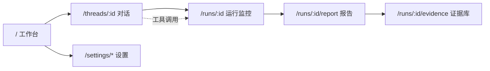

# DemandX 页面设计架构（UI Architecture）

- 状态：待用户评审（draft）
- 日期：2026-10-29
- 关联：`docs/superpowers/specs/2026-10-29-demandx-design.md`（数据模型、流水线、评分规则）
- 范围：页面清单、每个页面的技术栈、组件边界、数据流、交互与状态；不含视觉稿细节

## 1. 总体原则

| 原则 | 具体做法 | 反例（本项目不做） |
|---|---|---|
| 服务端优先 | 默认 React Server Component 直接用 Drizzle 读库；只有交互岛屿是 `'use client'` | 全站 SPA、客户端 fetch 首屏数据 |
| 零客户端数据层 | 不引入 React Query / SWR；读走 RSC，写走 Server Actions，进度走 SSE | 全局 store + 缓存失效策略 |
| 状态就近 | 筛选条件进 URL（nuqs），聊天状态归 `useChat`，其余用 `useState` | Redux / Zustand 全局状态 |
| 结构化渲染 | 报告是 JSON（claims + citations）→ React 组件，不是 Markdown 字符串 | 把报告存成 HTML 再 `dangerouslySetInnerHTML` |
| 依赖按需加载 | 图表（recharts）与拖拽（dnd-kit）动态导入，不进首屏 | 每个页面都预载整套组件库 |
| 单一事实 | 评分与可信度只来自 `scores` 表；页面不重算 | 前端再算一遍分数导致与报告不一致 |

## 2. 路由与页面清单



| # | 路由 | 页面 | 渲染 | 数据来源 | 主要交互 |
|---|---|---|---|---|---|
| 1 | `/` | 工作台 | RSC | `threads`、`runs`、`reports` | 新建对话、进入最近 run |
| 2 | `/threads/[threadId]` | 对话 | RSC 外壳 + 客户端岛屿 | `messages`、`runs`、`run_events` | 发消息、审批卡、追问引用 |
| 3 | `/runs/[runId]` | 运行监控 | RSC + SSE 客户端 | `runs`、`run_events`、`queries`、`sources` | 实时阶段推进、暂停、查看失败源 |
| 4 | `/runs/[runId]/report` | 报告 | RSC + 两个小岛屿 | `reports`、`scores`、`citations`、`evidence` | 目录跳转、引用侧栏、导出 Markdown、打印 |
| 5 | `/runs/[runId]/evidence` | 证据库 | RSC + 表格岛屿 | `evidence`、`sources` | 筛选（URL）、排序、看原文、人工确认 |
| 6 | `/settings/llm` | LLM 配置 | RSC + 表单岛屿 | `providers`、`provider_models`、`llm_chains`、`provider_usage` | CRUD、测试连接、拖拽链 |
| 7 | `/settings/crawl` | 采集设置 | RSC + 表单岛屿 | 环境配置 + `sources` 统计 | 平台会话登录、限速、`needs_human` 队列 |
| 8 | `/settings/general` | 数据与备份 | RSC | 表统计、快照目录 | 导出/清理快照、重建索引 |

## 3. 应用外壳

```
┌─────────────┬──────────────────────────────────┬───────────────┐
│ 侧栏 240px  │ 主区（宽度自适应）                │ 右栏 320px    │
│ · 新建研究  │  页面标题 + 面包屑 + 操作区       │ 上下文面板    │
│ · 线程列表  │                                  │ （可选）      │
│ · 最近 run  │                                  │               │
│ · 设置入口  │                                  │               │
└─────────────┴──────────────────────────────────┴───────────────┘
```

| 部件 | 实现 | 说明 |
|---|---|---|
| 外壳布局 | `src/app/(workbench)/layout.tsx`（RSC）+ CSS Grid | 侧栏在 `md` 以下折叠为抽屉 |
| 侧栏 | RSC 读最近 20 条线程/run + `cmdk` 命令面板入口 | 不做客户端分页 |
| 命令面板 | `cmdk@1.1.1` + shadcn `Command` | `⌘K`：新建研究、跳到 run、筛选证据 |
| 主题 | `next-themes@0.4.6`（class 策略） | 默认跟随系统；打印强制浅色 |
| 通知 | `sonner@2.0.8`（shadcn `Sonner`） | SSE 丢线、配额告警、保存成功 |
| 图标 | `lucide-react@1.64.0` | 统一 16/20px |
| 日期 | `date-fns@4.4.0` + `zhCN` locale | 相对时间 + `title` 绝对时间 |

## 4. 每页技术栈

### 4.1 工作台 `/`

| 层 | 选型 | 用途 |
|---|---|---|
| 渲染 | RSC | 直接 `db.select(...)` 取线程与最近 run |
| 组件 | shadcn `Card` / `Badge` / `Separator` | 列表与状态 |
| 样式 | Tailwind 4.3（CSS-first，无 `tailwind.config.js`） | 布局 |
| 数据 | Drizzle + `LEFT JOIN reports` | 显示最新决策与总分 |
| 交互 | 原生 `<form action={createThread}>` Server Action | 新建对话即跳转 |

空态：无线程时显示三条示例 Idea（点击填入输入框，不发请求）。加载态由 `loading.tsx` 的骨架屏承担（shadcn `Skeleton`）。

### 4.2 对话 `/threads/[threadId]`

| 层 | 选型 | 用途 |
|---|---|---|
| 聊天 hook | `@ai-sdk/react` 4.0.16（`useChat`） | 消息数组、流式 parts、`sendMessage` / `regenerate` / `stop` |
| 模型调用 | `ai@7.0.x`（`streamText` + `toUIMessageStreamResponse`） | `/api/chat` 流式响应；参考项目锁 7.0.15，本项目取 7.0.156 |
| 消息渲染 | `streamdown@2.7.1` + `@streamdown/cjk@^1.0.3` + `@streamdown/code@^1.0.3` | 中文断行与标点、代码块（shiki）；**不引入** math / mermaid 插件 |
| 滚动 | `use-stick-to-bottom@^1.1.6` | 流式贴底；用户上滚后自动暂停跟随，回到底部恢复 |
| 消息结构 | AI SDK `UIMessage.parts`（`text` / `tool-*` / `data-*`） | 工具卡、证据卡、run 卡都由 part 渲染，不解析自然语言 |
| UI 组件 | shadcn/ui + `radix-ui@^1.6.1`（统一包，不用散装 `@radix-ui/react-*`） + CVA | 按钮、Dialog、Sheet、Collapsible |
| Run 进度 | 原生 `EventSource` + `useReducer` | 订阅 `/api/runs/:id/stream?after_seq=` |
| 表单 | `react-hook-form` + `@hookform/resolvers` + `zod` | 仅“编辑检索角度”弹窗 |
| 状态 | `useChat`（消息）+ `useState`（展开态）+ URL（当前 runId） | 无全局 store |

关键规则：

- 服务端 `/api/chat` 用 `streamText` + `tool({ inputSchema: z.object(...) })`；工具结果以 `data-evidence` / `data-run` part 回传，前端只渲染结构化数据，不拼 HTML、不用 `dangerouslySetInnerHTML`。
- 助手文本中的 `[e12]` 在渲染时转成 `CitationChip`（不靠正则改 Markdown 源码，而在 Streamdown 之后的渲染层替换），点击打开右栏 `EvidenceSheet`。
- 审批卡是 `tool-start_research` 的 `state: 'input-available'` 渲染；确认后才调用 Server Action 建 run——工具本身不产生副作用。
- 断线：聊天流不做 Redis 级恢复（理由见 §9.1），重新进入页面由 RSC 读回已落库消息；run 进度靠 `after_seq` 续传。
- 输入框支持 `Enter` 发送 / `Shift+Enter` 换行；发送中按钮变为“停止”，与参考项目一致。

### 4.3 运行监控 `/runs/[runId]`

| 层 | 选型 | 用途 |
|---|---|---|
| 渲染 | RSC（首屏快照）+ 客户端岛屿（增量） | 首屏直接输出已完成事件，避免闪烁 |
| 实时 | `EventSource` + `run_events(seq)` 游标 | 阶段条、证据计数、告警 |
| 可视化 | 自定义时间线（CSS）+ shadcn `Progress` | 不用图表库 |
| 表格 | `@tanstack/react-table@9.3.1`（小表，无虚拟化） | 查询列表与失败源 |
| 交互 | `Pause`/`Resume` Server Action、`needs_human` 队列卡片 | 暂停只停后续请求，不回滚已写证据 |

阶段条固定七段（S0–S6），每段三态：等待/进行中/完成（失败红）。事件超过 200 条后只保留最近 200 条在内存，完整历史在证据页与 DB。

### 4.4 报告 `/runs/[runId]/report`

| 层 | 选型 | 用途 |
|---|---|---|
| 渲染 | RSC | `reports.sections` JSON → 八个 `<section>`，零客户端 JS 即可读 |
| 目录 | 原生锚点 + `IntersectionObserver`（10 行客户端组件） | 高亮当前小节 |
| 引用侧栏 | shadcn `Sheet`（移动端）/ 固定右栏（≥lg） | 展示 quote 原文、平台、时间、链接 |
| 评分图 | `recharts@3.10.1`（`next/dynamic`，`ssr:false`） | 七维雷达图 + 总分条 |
| 徽章 | shadcn `Badge` + 语义色 token | A–D 可信度、五类信号 |
| 证据内联 | 自定义 `Claim` 组件 | 论断 + `[eN]` chips + “无证据”灰标 |
| 导出 | Server Action 拼 Markdown 字符串（无第三方库） | 下载 `.md` |
| 打印 | `@media print` CSS | 隐藏侧栏与按钮，保留引用脚注 |

**布局**（≥1280px）：左侧目录 200px / 中间正文 max 760px / 右侧引用 320px（可折叠）。

```
┌──────────┬───────────────────────────────┬──────────────┐
│ 目录     │ 执行摘要                       │ 引用         │
│ 一 摘要  │ 结论：建议先验证 68/100 (C)    │ e12 小红书   │
│ 二 证据  │ ▸ 需求证据 [e3][e7][e12]      │ “一个月 99…” │
│ 三 竞品  │ ▸ 付费证据 [e19]              │ 2026-03-11   │
│ 四 排名  │ ─ 评分雷达（lazy）             │ 原文链接 ↗   │
│ 五 方向  │ ─ 竞品表                       │              │
│ 六 财务  │ ─ 14 天计划                    │              │
│ 七 计划  │ ─ 最终决策                     │              │
└──────────┴───────────────────────────────┴──────────────┘
```

空/降级态：`reports.unknowns` 非空时，每节末尾显示“本节未知项”折叠块；run 超时则首屏横幅标注“部分采集未完成”。

### 4.5 证据库 `/runs/[runId]/evidence`

| 层 | 选型 | 用途 |
|---|---|---|
| 表格 | `@tanstack/react-table@9.3.1` | 排序、列可见性、多选 |
| 虚拟化 | `@tanstack/react-virtual@3.14.24`（>200 行启用） | 长列表滚动性能 |
| 筛选状态 | `nuqs@2.10.2`（`?signal=paying&platform=reddit&q=`） | 可分享、可回退的筛选 |
| 详情 | shadcn `Sheet` + 高亮 `quote_offset` | 原文定位（滚动到 quote 并 `mark`） |
| 人工确认 | Server Action `confirmEvidence` / `rejectEvidence` | 写入 `rejected_reason='manual'`，评分随之重算 |

列：信号 / 平台 / 时间 / 原文摘要 / 支持什么 / 不能证明什么 / 一手 / 价格 / 状态。信号列用固定五色 token（见 §6）。

### 4.6 LLM 配置 `/settings/llm`

| 层 | 选型 | 用途 |
|---|---|---|
| 表单 | `react-hook-form` + `zodResolver`；同一 zod schema 服务端复用 | provider 新增/编辑、额度声明 |
| 拖拽 | `@dnd-kit/core@6.3.1` + `@dnd-kit/sortable@10.0.0` + shadcn `Card` | bulk / quality 两条链排序 |
| 对话框 | shadcn `Dialog` / `AlertDialog` | 删除确认、PAYG 二次确认 |
| 列表 | shadcn `Table`（无虚拟化） | provider 与 usage |
| 测试连接 | `fetch` → Server Action → 回填结果 | 延迟、状态码、原样错误 |
| 反馈 | `sonner` | 保存/测试结果 |

区块顺序与交互：

1. **Providers**：卡片列表 → 新增（模板选择）→ 填 Base URL / Key / headers → 保存；Key 输入框 `type=password`，保存后只显示掩码。
2. **Models**：选中 provider 后展示；“拉取模型”按钮触发 `GET {base}/models`（Ollama 用 `/api/tags`），失败则手填；不可外部调用的模型显示灰色 `仅官方客户端` 标签。
3. **Chains**：两列 sortable 列表；不可用 provider 置灰但保留位置；保存前校验非空并提示“该链当前全为本地模型”。
4. **Usage**：5h / 周 / 月三个进度条，数据来自 `provider_usage`；“重置窗口”只清本地计数并二次确认。

### 4.7 采集设置 `/settings/crawl`

| 层 | 选型 | 用途 |
|---|---|---|
| 表单 | `react-hook-form` + zod | 每域名并发、间隔、页数上限、总时长 |
| 平台卡 | shadcn `Card` + `Badge` | 小红书/抖音/知乎的会话状态（已登录/需登录/过期） |
| 登录 | Server Action 起子进程 `scripts/crawl-login.ts`（Playwright 有头） | 点击后显示“请在弹出的浏览器完成登录”，轮询状态 |
| 队列 | `@tanstack/react-table` | `needs_human` 列表：URL、原因、重试按钮 |

### 4.8 数据与备份 `/settings/general`

| 层 | 选型 | 用途 |
|---|---|---|
| 统计 | RSC + `count(*)` | 各表行数、快照占用 |
| 操作 | Server Actions | 清理 90 天前快照、导出证据 JSONL、VACUUM |
| 危险操作 | `AlertDialog` + 输入表名确认 | 清空指定 run |

## 5. 跨页共享组件

| 组件 | 路径 | 被谁用 | 依赖 |
|---|---|---|---|
| `SignalBadge` | `components/common/signal-badge.tsx` | 报告、证据库、聊天卡片 | 五色 token |
| `CredibilityBadge` | `components/common/credibility-badge.tsx` | 报告、工作台、运行页 | 同上 |
| `CitationChip` | `components/report/citation-chip.tsx` | 报告正文、聊天消息 | 打开 Sheet 的 context |
| `EvidenceSheet` | `components/evidence/evidence-sheet.tsx` | 报告、聊天、证据库 | shadcn Sheet |
| `EmptyState` | `components/common/empty-state.tsx` | 全部页面 | 无 |
| `PageHeader` | `components/common/page-header.tsx` | 全部页面 | 面包屑 + 操作槽 |
| `ConfirmDialog` | `components/common/confirm-dialog.tsx` | 设置页、危险操作 | AlertDialog |

## 6. 设计 token（语义化，不用品牌色）

```css
/* globals.css，Tailwind 4 @theme 内声明 */
--signal-problem:   var(--c1);
--signal-seeking:   var(--c2);
--signal-paying:    var(--c3);
--signal-switching: var(--c4);
--signal-recurring: var(--c5);
--grade-a: var(--success);
--grade-b: var(--c1);
--grade-c: var(--warning);
--grade-d: var(--error);
```

规则：五类信号与 A–D 在**所有页面**使用同一映射；图表序列色只用 `--c1`…`--c6`；不引入第二套色板。

## 7. 状态、错误与可访问性

| 场景 | 处理 |
|---|---|
| RSC 查询慢 | 每页 `loading.tsx` 骨架；证据页骨架只保留表头与 8 行 |
| 数据不存在 | `not-found.tsx` 区分“run 不存在”与“run 未完成报告” |
| 服务端异常 | 路由级 `error.tsx`，显示 `digest` 便于查日志，不显示堆栈 |
| SSE 断线 | `sonner` 提示 + 指数退避重连（1s→8s，最多 5 次），保留已渲染事件 |
| 表单校验失败 | 字段级错误（zod message），顶部汇总一条；不 toast 刷屏 |
| 键盘 | 所有操作可 Tab 到达；`⌘K` 面板；Sheet 关闭后焦点回到触发 chip |
| 屏幕阅读器 | SSE 新事件写入 `aria-live="polite"` 的隐藏区域，限流 1 条/2s |
| 打印 | 报告页专有样式：隐藏导航、展开所有折叠块、引用改为脚注 |

## 8. 性能预算

| 指标 | 目标 | 手段 |
|---|---|---|
| 首屏 JS（对话页） | < 180 KB gzip | `useChat` + Streamdown 按路由拆包；`@streamdown/code` 只在出现代码块时懒加载 |
| 首屏 JS（报告页） | < 60 KB gzip | 只有目录观察器与引用 Sheet 是客户端 |
| 图表 | 不阻塞首屏 | `next/dynamic` + `ssr:false`，滚动到可视区再挂载 |
| 证据表 | >200 行仍 60fps | react-virtual 行虚拟化 |
| 本地首字节 | < 300 ms | RSC 直连本机 Postgres，无外部请求 |

## 9. 依赖清单（本 UI 层新增）

| 包 | 版本（实测） | 用途 | 是否客户端 |
|---|---|---|---|
| `next` | 16.4.3 | 路由、RSC、Server Actions | — |
| `react` / `react-dom` | 19.3.1 | UI | — |
| `tailwindcss` | 4.3.3 | 样式（CSS-first） | 否 |
| `shadcn` (CLI) | 4.23.0 | 组件源码入库（Radix 或 Base UI 风格二选一，全项目统一；Base UI 目前为 `1.0.0-rc.0`，选它需接受 RC） | 混合 |
| `class-variance-authority` | 0.7.1 | 变体 API | 混合 |
| `clsx` / `tailwind-merge` | 2.1.1 / 3.7.0 | `cn()` | 混合 |
| `@ai-sdk/react` | 4.0.16（对齐参考项目） | `useChat` 聊天状态与流式 parts | 是 |
| `ai` | 7.0.156（参考项目锁 7.0.15） | `streamText`、工具定义、UIMessage 流 | 服务端 + 客户端 hooks |
| `streamdown` | 2.7.1 | 流式 Markdown | 是 |
| `@streamdown/cjk` | ^1.0.3 | 中文断行/标点（中文界面的必选项，参考项目用它） | 是 |
| `@streamdown/code` | ^1.0.3 | 代码块高亮（内置 shiki） | 是 |
| `use-stick-to-bottom` | ^1.1.6 | 聊天贴底滚动 | 是 |
| `radix-ui` | ^1.6.1 | shadcn 的底层统一包（替代散装 `@radix-ui/react-*`） | 是 |
| `@tailwindcss/typography` | ^0.5.20 | 报告正文与 assistant 长文的 `prose` 排版 | 否 |
| `postgres` | ^3.4.9 | Drizzle 的 postgres.js 驱动（与参考项目一致） | 否 |
| `@tanstack/react-table` | 9.3.1 | 证据/查询/队列表格 | 是 |
| `@tanstack/react-virtual` | 3.14.24 | 长列表虚拟化 | 是 |
| `recharts` | 3.10.1 | 七维雷达图 | 是（懒加载） |
| `react-hook-form` | 7.91.0 | 设置页与弹窗表单 | 是 |
| `@hookform/resolvers` | 6.0.2 | zod 解析 | 是 |
| `zod` | 4.6.7 | 前后端共享 schema | 混合 |
| `@dnd-kit/core` / `@dnd-kit/sortable` | 6.3.1 / 10.0.0 | 链排序 | 是 |
| `nuqs` | 2.10.2 | 筛选条件进 URL | 是 |
| `next-themes` | 0.4.6 | 主题 | 是 |
| `sonner` | 2.0.8 | Toast | 是 |
| `cmdk` | 1.1.1 | 命令面板 | 是（懒加载） |
| `lucide-react` | 1.64.0 | 图标 | 混合 |
| `date-fns` | 4.4.0 | 时间格式化 | 混合 |
| `vitest` / `@testing-library/react` | 5.0.5 / 16.3.3 | 组件单测 | 否 |
| `@playwright/test` | 1.64.1 | E2E | 否 |

**明确不引入**：React Query/SWR（RSC 已覆盖）、Redux/Zustand（无跨页共享状态）、react-markdown（报告是结构化 JSON，聊天用 Streamdown）、任意整套 UI 框架（MUI/AntD/Chakra，与 shadcn 冲突）、图表之外的动画库、i18n 框架（仅中文）。

### 9.1 与 vercel/chatbot（v3.1.0）的对齐与偏差

参考项目 `github.com/vercel/chatbot` 的 `package.json` 已逐项核对。**AI 相关库全部对齐**，非 AI 的取舍按下表说明。

| 参考项目的做法 | 本项目 | 理由 |
|---|---|---|
| `ai@7.0.15` + `@ai-sdk/react@4.0.16` | ✅ 采用（`ai` 取 7.0.156） | 同一套 `UIMessage` parts 模型，工具卡与 data part 直接复用 |
| `streamdown` + `@streamdown/cjk` + `@streamdown/code` | ✅ 采用 | CJK 插件解决中文断行；`code` 用 shiki；不装 math / mermaid 插件（报告不产公式与图） |
| `use-stick-to-bottom` | ✅ 采用 | 流式输出贴底，避免自写 scroll 逻辑 |
| `radix-ui` 统一包 + shadcn/ui + Tailwind 4 + typography | ✅ 采用 | 与参考项目同源，组件可直接拷 |
| `drizzle-orm` + `postgres` 驱动 | ✅ 采用 | 驱动换成 postgres.js，与参考项目一致 |
| `resumable-stream` + `redis`（断线续流） | ❌ 暂不引入 | 单机单用户；消息已落 Postgres，重进页面由 RSC 读回；run 进度用 `run_events.seq` 续传。需要按 token 级恢复时再加（只需 `/api/chat` 一层） |
| `swr`（客户端取数） | ❌ 不引入 | 读全部走 RSC；唯一实时源是 SSE |
| `next-auth` + `bcrypt-ts` + `botid` | ❌ 不引入 | 单用户 localhost，无鉴权需求；引入反而增加攻击面 |
| AI Gateway（OIDC / `AI_GATEWAY_API_KEY`） | ⚠️ 可选 | 若使用，只是在配置页加一条 openai-compatible provider；默认不加 |
| `@ai-sdk/otel` + `@vercel/otel`（链路追踪） | ❌ 暂不引入 | 本地单机，`api_calls` 表已记录 provider/模型/token；需要时再加 |
| Artifacts 栈（ProseMirror / CodeMirror / react-data-grid / papaparse / diff-match-patch） | ❌ 不引入 | 那是文档编辑类产品的能力，与本项目“证据 + 报告”无关 |
| `motion` / `framer-motion` | ❌ 不引入 | 仅用 CSS transition；动画不是价值点 |
| `ultracite` + Biome（lint/format） | ✅ 建议采用 | 比 ESLint+Prettier 少一半配置；与参考项目一致 |
| Playwright 作为唯一测试运行器 | ⚠️ 部分采用 | 我们保留 vitest 做纯函数与组件单测（评分/闸门必须可单测），E2E 仍用 Playwright |

## 10. 页面级测试

| 页面 | 单测（vitest + RTL） | E2E（Playwright） |
|---|---|---|
| 对话 | `UIMessage` parts 渲染（`text` / `tool-*` / `data-*`）、引用 chip、停止按钮状态 | 发消息 → 审批 → run 卡片推进 → 追问 |
| 运行监控 | SSE reducer（乱序/重复 seq/断线续传） | 断线重连后事件不丢 |
| 报告 | Claim 无引用 → 灰标、评分合计 = 总分 | 目录跳转、引用侧栏定位 quote、导出 md |
| 证据库 | 筛选 URL 解析、虚拟列表行映射 | 筛选后刷新页面条件保持 |
| LLM 配置 | 链保存校验（空链、重复项）、掩码回显 | 新增 provider → 测试 → 拖拽 → 保存生效 |
| 采集设置 | 限速参数边界校验 | 点登录 → 状态变为“已登录”（mock 子进程） |

## 11. 与主规格的边界

- 本文件只管**页面与前端选型**；数据模型、评分规则、流水线、配额语义以主规格为准。
- 任何新增页面需在此表登记（路由、渲染方式、依赖），避免出现第二个数据获取范式。
- 前端**不计算**分数、可信度、决策；只展示 `scores` / `reports` 的既有结果。

## 12. 已确认的布局决策（2026-10-29）

已按线框图评审确认，后续实现不得偏离；如需改动先改本节。

| 决策 | 结论 | 实现要点 |
|---|---|---|
| 对话页 | **三栏常驻** | 侧栏 240 / 主区自适应（min 520）/ 右栏 320 |
| 报告页 | **三栏常驻** | 目录 200 / 正文 max 760 / 引用 320；正文实际可用约 480–560 |
| 信息密度 | **紧凑** | 表格行高 32、正文 12px、辅助信息 10px、间距为 8 的倍数 |
| 信号配色 | **语义色** | 见下表；不使用第二套色板 |

**信号与等级映射（唯一来源）**

| 语义 | token | 使用位置 |
|---|---|---|
| 付费 / 已确认 / A 级 | `--success` | 证据表、报告徽章、图表序列 |
| 问题存在 | `--accent` | 信号列 |
| 主动寻找 | `--c2` | 信号列 |
| 愿意更换 | `--warning` | 信号列 |
| 持续 / 续费 | `--c4` | 信号列 |
| 驳回 / quote 校验失败 / D 级 | `--error` | 证据表、报告徽章 |
| B 级 | `--c1` | 报告徽章 |
| C 级 | `--warning` | 报告徽章 |

**响应式规则**

| 断点 | 对话页 | 报告页 | 证据库 |
|---|---|---|---|
| ≥1280 | 三栏常驻 | 三栏常驻 | 表格 + 抽屉并排 |
| 1024–1279 | 三栏，右栏可折叠 | 两栏 + 引用抽屉 | 抽屉覆盖表格 |
| 768–1023 | 侧栏变图标栏，右栏变底部抽屉 | 单栏 + 顶部目录菜单 | 单列卡片 |
| <768 | 侧栏抽屉，右栏全屏 Sheet | 单栏，引用全屏 Sheet | 单列卡片，筛选为 Sheet |

## 13. 设计稿与可交互原型

**主交付物是可交互原型**（真实 DOM + CSS 动效 + 图标），静态 SVG 仅保留作尺寸参考。

| 产物 | 位置 | 说明 |
|---|---|---|
| 可交互原型 | `docs/design/prototype/index.html`（+ `app.css`、`app.js`） | 5 个页面切换、抽屉、进度动画、测试连接、主题切换 |
| 原型截图 | `docs/design/prototype/shot-{chat,report,evidence,evidence-drawer,settings,chat-dark}.png` | 2x，用于评审留档 |
| 静态线框 | `docs/design/mockups/*.svg` + `.png` | 尺寸与栅格基准，非最终观感 |
| 线框索引 | `docs/design/mockups/index.html` | 一次性浏览 7 张线框 |

本地预览：

```bash
python3 -m http.server 8788 --directory docs/design/prototype   # 原型
python3 -m http.server 8787 --directory docs/design/mockups     # 线框
```

**原型里可验证的交互**

| 交互 | 位置 | 预期 |
|---|---|---|
| 页面切换 | 左侧导航 / 表格行 | 淡入切换，标题同步 |
| 引用定位 | 报告与聊天中的 `e12` / `e19` | 右侧抽屉滑入，显示原文与“不能证明” |
| 研究启动 | 对话页审批卡 | 按钮进入 loading，进度条推进，阶段文字更新 |
| 证据筛选 | 证据库筛选 chips | 激活态切换，计数随之变化 |
| 连接测试 | 设置页“测试 OpenCode Go” | 1.4s 后返回状态码、延迟、allowance |
| 主题切换 | 侧栏底部图标 | 亮/暗两套 token，全站即时切换 |
| 评分图 | 报告页 | 雷达图入场缩放动画 |
| 滚动同步 | 报告目录 | 视口进入小节时目录高亮 |

**设计系统要点**

- 图标：内联 SVG sprite（Lucide 风格，1.8px 描边），无外部依赖。
- 动效：`fadeUp .28s`、抽屉 `translateX .32s`、进度条 `1.1s` 缓动 + shimmer、脉冲点 1.6s；全部尊重 `prefers-reduced-motion`。
- 颜色：语义 token（`--accent/--success/--warning/--error` + `--c1..--c4`），亮暗各一套；不使用硬编码色值。
- 平台标识：小红书 / Reddit / HN / App Store / 知乎 / V2EX / 抖音 / GitHub 用品牌色单字徽章，不引入第三方 logo 资源。
